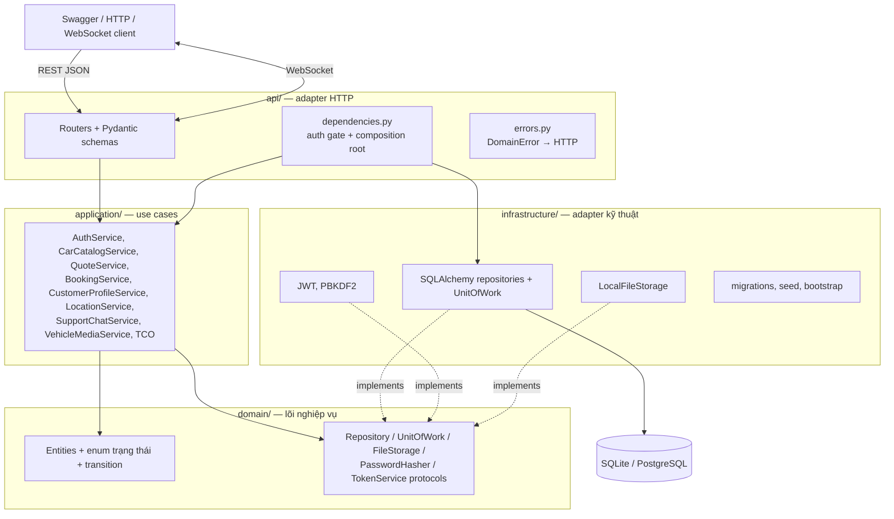
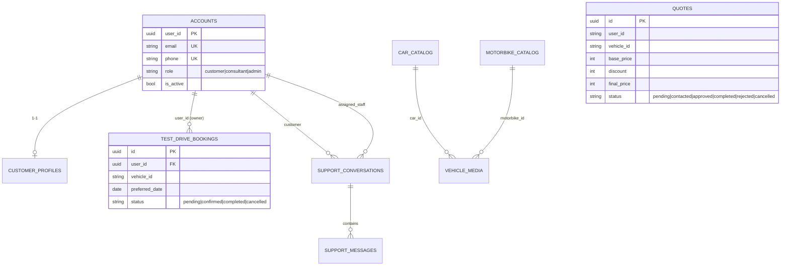
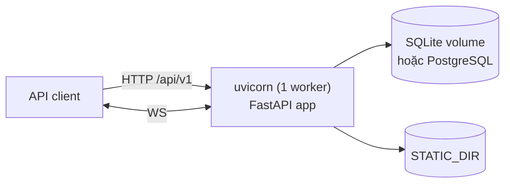

# Kiến trúc hệ thống

## Mục tiêu và giới hạn

Pha 1 ưu tiên tính đúng, dễ đọc và kiểm thử được trên một máy. Nghiệp vụ trọng tâm là chuyển nhu cầu quan tâm xe từ kênh online sang nhân viên thật qua báo giá, lịch lái thử và hội thoại realtime. Pha 1 cố ý **chưa tối ưu** (không cache, không pagination catalog, một worker) để có baseline đo được trước khi cải tiến ở Pha 2.

## Phân tầng



Trách nhiệm từng tầng:

| Tầng | Được làm | Không được làm |
|---|---|---|
| `api/` | Parse/validate request bằng Pydantic, chọn status code, gọi đúng một use case, map `DomainError` sang HTTP, xác thực qua dependency | Truy vấn DB, import SQLAlchemy, chứa quy tắc nghiệp vụ |
| `application/` | Điều phối repository trong một Unit of Work, kiểm tra quyền nghiệp vụ (owner/staff/admin), commit đúng một lần | Import FastAPI, Pydantic, SQLAlchemy, JWT, passlib |
| `domain/` | Entity (dataclass), enum + bảng chuyển trạng thái, chuẩn hóa dữ liệu, lỗi nghiệp vụ, protocol | Import bất kỳ tầng nào khác hoặc thư viện hạ tầng |
| `infrastructure/` | ORM, repository, transaction, JWT, băm mật khẩu, lưu file, migration, seed | Import tầng web |

Các quy tắc trên được `backend/tests/test_architecture.py` kiểm tra bằng AST trên **mọi file** của từng tầng, cùng với việc mọi route phải do module trong `api/` phục vụ và các package trộn tầng cũ (`models/`, `services/`, `repositories/`) không được xuất hiện lại.

### Luồng một request: tạo báo giá

```text
POST /api/v1/quotes {vehicle_id, request_note}
  api/quotes.py            Pydantic QuoteCreate → get_current_user (JWT) → QuoteService.request_quote
  application/quotes.py    find_vehicle (giá + tên từ catalog) → Quote(...) → quotes.add
                           → profile.record_quote(...) → customer_profiles.save → uow.commit()
  infrastructure/...       SqlAlchemyQuoteRepository / SqlAlchemyCustomerProfileRepository (flush, không commit)
  api/errors.py            NotFoundError→404, ValidationError→422, ...
```

Client chỉ gửi `vehicle_id`; tên xe, giá niêm yết, `final_price` và danh tính khách hàng đều do backend xác định.

## Transaction và Unit of Work

- Repository chỉ `flush`, không bao giờ `commit`.
- Mỗi request nhận một `SqlAlchemyUnitOfWork` (một `AsyncSession`) qua dependency `get_uow`; use case gọi `uow.commit()` đúng một lần khi toàn bộ thay đổi hợp lệ.
- Khi có lỗi, context manager rollback; ví dụ đăng ký tài khoản và tạo hồ sơ CRM là một transaction, tạo báo giá/lịch lái thử và cập nhật CRM là một transaction.
- Upload ảnh: file được lưu trước, rồi ghi DB; nếu ghi DB thất bại, file vừa lưu bị xóa.

## Mô hình dữ liệu



### Trạng thái nghiệp vụ

| Đối tượng | Chuyển trạng thái hợp lệ |
|---|---|
| Quote | `pending → contacted/approved/rejected/cancelled`; `contacted → approved/rejected/cancelled`; `approved → completed/cancelled`; `completed`, `rejected`, `cancelled` là trạng thái cuối |
| Booking | `pending → confirmed/cancelled`; `confirmed → completed/cancelled`; `completed`, `cancelled` là trạng thái cuối |
| Conversation | `open → closed` |
| Role | `customer`, `consultant`, `admin` (enum, không nhận giá trị khác) |

Chuyển sai trả `409 Conflict`; giá trị ngoài enum trả `422`.

### Migration

`Base.metadata.create_all` chỉ tạo bảng thiếu. `infrastructure/migrations.py` bổ sung các bước nâng cấp idempotent chạy mỗi lần khởi động:

1. `0001` — thêm `test_drive_bookings.user_id` và backfill **chỉ khi** số điện thoại cũ khớp đúng một tài khoản; trường hợp mơ hồ để trống (chỉ nhân viên thấy) thay vì gán nhầm chủ.
2. `0002` — tạo unique index `accounts.phone` nếu dữ liệu hiện có không trùng; nếu trùng thì ghi cảnh báo, không làm sập khởi động.

Pha 2 nên chuyển sang Alembic.

## Bảo mật

- Mật khẩu băm bằng **PBKDF2-SHA256** (passlib, có salt); JWT HS256 ký bằng `SECRET_KEY`, có `sub`, `role`, `iat`, `exp`.
- `api/dependencies.py::get_current_user` là cổng xác thực duy nhất cho HTTP (security scheme `HTTPBearer` trong OpenAPI); `require_roles` thực hiện RBAC. WebSocket dùng cùng `AuthService.authenticate` trước khi `accept`.
- Quyền sở hữu luôn dựa trên **UUID tài khoản trong token**: booking lưu `user_id`; customer chỉ nhận dữ liệu của mình dù gửi bộ lọc nào. Số điện thoại/email không còn là khóa sở hữu (đã có test hồi quy cho trường hợp tái sử dụng số điện thoại).
- Email và số điện thoại là duy nhất; đăng ký công khai luôn tạo `customer`; chỉ admin đổi role/khóa tài khoản; admin không tự hạ quyền, tự khóa hay tự xóa.
- Tài khoản bị khóa: không đăng nhập được (403) và token cũ bị từ chối (401).
- Upload ảnh kiểm tra kích thước (mặc định 8 MB), phần mở rộng, MIME khai báo và **chữ ký tệp** (magic bytes); tên file được làm sạch và gắn hậu tố ngẫu nhiên; đường dẫn lưu không thể thoát khỏi `STATIC_DIR`.
- CORS dùng allowlist; production từ chối `*` và secret yếu. Lỗi không dự kiến trả JSON chung, không lộ stack trace.
- Container chạy user không phải root; secret chỉ truyền qua biến môi trường.

## Triển khai



- Docker image: `backend/Dockerfile`, multi-stage, dependency khóa bằng `constraints.txt`, user `appuser` (uid 10001).
- Healthcheck `/health` chạy `SELECT 1`; DB không truy cập được → HTTP 503 → container `unhealthy`.
- Với `APP_ENV=production`, ứng dụng từ chối khởi động nếu `SECRET_KEY` yếu hoặc `CORS_ORIGINS` chứa `*` (`Settings.validate_for_runtime`).
- WebSocket connection manager nằm trong bộ nhớ một process; tin nhắn luôn được commit trước khi broadcast nên REST history là nguồn sự thật.

## Khả năng kiểm thử

- Unit test nghiệp vụ dùng fake Unit of Work/in-memory repository (`tests/unit/`), không cần FastAPI hay DB.
- Integration test dùng SQLite tạm, **database được tạo lại cho từng test**.
- Contract test duyệt toàn bộ OpenAPI: security khớp chính sách truy cập, request body là JSON trừ 3 endpoint upload, mọi operation có schema response, và **mọi** GET/POST được bảo vệ thực sự trả 401 khi thiếu hoặc sai token.
- `docs/openapi.json` được so khớp với runtime trong test.
- CI build image và chạy smoke test thật trên container.

## Thuộc tính chất lượng Pha 2

Mỗi cải tiến phải đo trên cùng Kaggle CPU, cùng dataset, concurrency, duration và commit.

| Thuộc tính | Baseline Pha 1 | Cải tiến đề xuất | Chỉ số trước/sau |
|---|---|---|---|
| Hiệu năng đọc catalog | Query trực tiếp | Pagination, index, response cache có TTL | RPS, p50/p95/p99, error rate |
| Khả năng mở rộng realtime | Connection manager trong 1 process | Redis Pub/Sub và nhiều worker | concurrent sockets, delivery latency, loss rate |
| Tin cậy | Commit rồi broadcast | outbox/event relay và idempotency key | duplicate/lost event rate |
| Dễ thay đổi DB | `create_all` | Alembic migration + rollback drill | thời gian deploy/rollback, migration failures |
| Quan sát | application log | request ID, structured log, Prometheus metrics | MTTD, error trace coverage |
| Bảo mật | access JWT | short-lived access + refresh rotation, rate limit | blocked abuse rate, token exposure window |

Không triển khai tất cả chỉ để “có công nghệ”. Nhóm chọn 1–2 nút thắt được baseline chứng minh, ghi giả thuyết, thay đổi một biến và báo cáo kết quả lặp tối thiểu ba lần.

## ADR ngắn

### ADR-01: Bốn package theo tầng thay vì `models/services/repositories`

Cấu trúc cũ để ORM model, Pydantic schema, nghiệp vụ và truy vấn trộn lẫn; quy tắc phụ thuộc chỉ đúng ở module chat. Tách `api/application/domain/infrastructure` giúp quy tắc có thể kiểm tra máy móc trên toàn bộ mã.

### ADR-02: Unit of Work thay vì repository tự commit

Use case cần ghi nhiều bảng (quote + CRM) một cách nguyên tử. Repository chỉ flush; use case quyết định ranh giới transaction.

### ADR-03: WebSocket + REST thay vì chỉ WebSocket

REST đơn giản cho history/retry và có trong OpenAPI; WebSocket chỉ đảm nhiệm push realtime.

### ADR-04: Catalog JSON, upload ảnh là endpoint multipart riêng

CRUD catalog nhận JSON để thống nhất hợp đồng; tải ảnh là dữ liệu nhị phân nên tách thành `POST /cars/{id}/image`, `POST /motorbikes/{id}/image` và `POST /catalog-media/{type}/{id}/upload`. Đây là các ngoại lệ duy nhất, được contract test khóa lại.

### ADR-05: Dữ liệu tham chiếu nằm trong repo và được seed khi DB rỗng

`data/catalog/vehicles.json` có thể review qua diff; ứng dụng nạp vào bảng rỗng và không ghi đè chỉnh sửa của admin. Docker image không còn phụ thuộc mã nguồn frontend để có dữ liệu.

### ADR-06: SQLite local, PostgreSQL dùng chung

SQLite giảm thời gian setup và dùng cho baseline Kaggle; PostgreSQL cho môi trường dùng chung. Toàn bộ truy cập qua SQLAlchemy async; cả hai được kiểm thử bằng smoke test.
